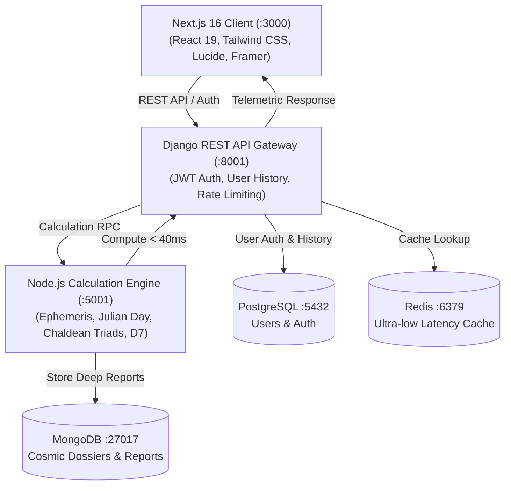

# 🌌 Cosmic Blueprint — Enterprise Vedic Astrology & Numerology Engine

> An enterprise-grade, microservice-powered platform unifying authentic **Vedic Jyotish (Astronomical Ephemeris)** and **Chaldean Numerology (Sacred Name Triads & Lo Shu Grid)** with predictive intelligence and real-time dossier generation.

---

## 🏛️ System Architecture



---

## ✨ Key Features & Engine Depth

1. **Authentic Astronomical Ephemeris (Vedic Jyotish)**:
   - True Julian Day (JD) at Greenwich Mean Time (GMT).
   - Accurate **Lahiri Ayanamsa** correction from tropical to sidereal longitudes.
   - Exact local sidereal time (RAMC + geographic obliquity) for accurate Ascendant (**Lagna**).
   - Real-time North Indian diamond Kundli rendering with dynamic House-to-Sign numbering.
   - Comprehensive Yoga & Dosha identification: *Gaja Kesari*, *Lakshmi*, *Budhaditya*, *Manglik*, and *Kala Sarpa*.

2. **Chaldean Sacred Namology & Destiny Triads**:
   - Computes First Name Energy, Lineage/Last Name Energy, and Combined Destiny Triad.
   - Filtered active Sacred Power Table (1–9 archetypes with Hindi & Gujarati descriptions).

3. **Predictive Life Dossier**:
   - **Career & Wealth Milestones**: Concrete age intervals for foundation, peak acceleration, and authority.
   - **Marriage & Partner Compatibility**: Expected partner starting phonetics and harmony indices.
   - **Progeny & Children Matrix**: Vedic *Saptamsa (D7)* alignment with realistic count and dynamics.
   - **Aura & Scent Calibration**: Personalized fragrance notes (e.g., Mysore Sandalwood, Oud, White Amber) to stabilize planetary energies.

4. **Production-Ready PDF Dossier Export**:
   - Auto-formatted filename: `CosmicBlueprint_{Name}.pdf`.
   - Dedicated print stylesheet stripping navigation, login/logout buttons, and web clutter for a clean client presentation.

---

## 🐳 Docker Hub Pre-Built Images

All core microservices are packaged as lightweight, multi-stage production Docker images:

| Service | Docker Hub Repository | Description |
| :--- | :--- | :--- |
| **Frontend** | `harry2410/cosmic-frontend:latest` | Next.js 16 Production Server |
| **Node Engine** | `harry2410/cosmic-node:latest` | Ephemeris & Numerology Engine |
| **Django Gateway** | `harry2410/cosmic-django:latest` | REST Gateway & Authentication |

### Pulling Pre-built Images from Docker Hub
```bash
docker pull harry2410/cosmic-frontend:latest
docker pull harry2410/cosmic-node:latest
docker pull harry2410/cosmic-django:latest
```

---

## 🚀 Quickstart with Docker Compose

To run the entire 6-container cluster locally in a single command:

```bash
# Clone the repository
git clone https://github.com/harry2410/Cosmic-Blueprint.git
cd Cosmic-Blueprint

# Start all microservices (Postgres, Mongo, Redis, Django, Node, Frontend)
docker compose up -d
```

### Cluster Ports & Endpoints
- **Frontend Application**: [http://localhost:3000](http://localhost:3000)
- **Django API Gateway**: [http://localhost:8001](http://localhost:8001)
  - Health Endpoint: `GET http://localhost:8001/api/health/`
  - Authentication: `POST http://localhost:8001/api/auth/register/` & `login/`
- **Node.js Calculation Engine**: [http://localhost:5001](http://localhost:5001)
  - Chart Ephemeris: `POST http://localhost:5001/api/astrology/chart`
  - Numerology Triads: `POST http://localhost:5001/api/numerology/calculate`

---

## 🛠️ CI/CD & Automated Updates

The repository includes a battle-tested GitHub Actions workflow (`.github/workflows/main.yml`) that:
1. Runs automated tests across Django and Node.js microservices on every pull request.
2. Automatically builds and pushes updated production images to **Docker Hub** on every push to `main`:
   - Builds `cosmic-frontend`, `cosmic-node`, and `cosmic-django`.
   - Tags with `:latest` and Git commit SHA.

---

## 👤 Author & Maintainer

- **Developer**: Hershil Mehta
- **GitHub**: [@harry2410](https://github.com/harry2410)
- **Docker Hub**: [harry2410](https://hub.docker.com/u/harry2410)
